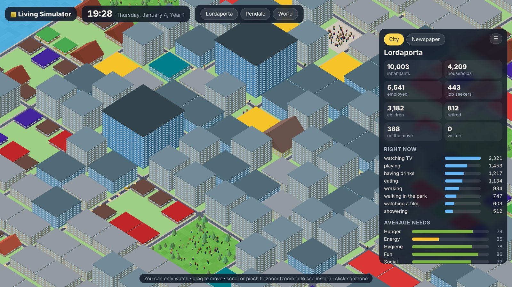

# Living Simulator

*[Read in English](README.md)*

**Una ciudad compartida que vive sola.** Living Simulator es una simulación de vida
open source con gráficos low-poly que funciona en el navegador. Unos 10.000 habitantes
trabajan, van al colegio, compran, comen fuera, ven la tele, duermen, pagan el alquiler
y visitan el pueblo de al lado. Hacen amigos, se enamoran, se casan, tienen o adoptan
hijos, envejecen, enferman y acaban muriendo, y la gente del pueblo va a trabajar a la
ciudad. Las empresas contratan, despiden y a veces quiebran, y el ayuntamiento cobra
impuestos. Los pueblos **crecen**: cuando faltan viviendas, tiendas, guarderías o empleo,
los inversores pagan edificios nuevos que los obreros levantan planta a planta, y se abren
calles nuevas hacia el campo. Siguen sus propias necesidades y agendas, y nadie los controla. **Tú solo
observas.** Todos los visitantes ven la misma ciudad en el mismo momento, y sigue viviendo
aunque nadie la mire.

**▶ Demo en vivo: <https://carlesclimentoltra.github.io/LivingSimulator/>**



- **Tiempo real:** 1 día simulado = 1 hora real (1 minuto simulado = 2,5 segundos).
- **Un único mundo para todos:** la simulación es determinista, así que tu navegador
  calcula exactamente la misma ciudad que el de cualquier otra persona.
- **Sin servidores, sin registro, sin coste:** GitHub Actions hace avanzar el mundo y
  GitHub Pages lo sirve. No usa APIs de pago ni IA generativa.
- **Preparado para crecer:** el mundo se divide en regiones (pueblos y ciudades) que solo
  se comunican mediante mensajes. El objetivo son cientos de pueblos y hasta un millón de
  habitantes (consulta la [hoja de ruta](docs/ROADMAP.md)).

## Qué puedes hacer

- Arrastra para moverte y usa la rueda o el pellizco para hacer zoom. Si te acercas
  mucho, los edificios se vuelven transparentes y puedes ver a la gente durmiendo,
  trabajando en su mesa o viendo la tele.
- Haz clic en cualquier persona para abrir su **ficha**: nombre, edad, familia, empleo,
  necesidades, dinero y un **diario** con sus últimos momentos. Pulsa *Follow* para que la
  cámara la siga.
- Haz clic en un edificio para ver quién está dentro y, si es un negocio, su dueño,
  precios, stock, plantilla y las cuentas de ayer.
- Mira cómo crece la ciudad: obras valladas, andamios y grúas, obreros con casco amarillo
  y un panel de *Construction* con cada proyecto, quién lo paga y cuánto falta. Haz clic en
  una obra para ver qué se está construyendo.
- Consulta la economía: paro, precio de una comida, alquileres y presupuesto municipal,
  con gráficas de los últimos 60 días.
- Consulta las **estadísticas** de la ciudad y el **periódico** local, y cambia entre la
  ciudad y el pueblo que hay al otro lado de la autopista.

No puedes hacer nada más. Nada de lo que hagas puede cambiar el mundo.

## Cómo funciona

- **`livingsim-core`** es una simulación pura y determinista. No hace I/O, no consulta el
  reloj y no usa números de coma flotante. Su azar sale solo de semillas y siempre itera
  en un orden fijo. Funciona **por eventos**: cada agente programa su próxima decisión, así
  que el coste crece con el número de eventos y no con agentes × ticks.
- Las **regiones** (una por pueblo) intercambian **mensajes** cada hora simulada. Por eso
  el navegador puede simular una sola región por su cuenta y obtener un resultado idéntico
  al del runner.
- El runner de GitHub Actions trabaja **por delante del tiempo real** (6 horas). Si el cron
  se retrasa o falla, los visitantes no lo notan.
- **El contenido son datos.** Las profesiones, los edificios, las actividades, los
  horarios, las sílabas de los nombres y las plantillas del periódico son archivos RON en
  [`/data`](data/).

Tienes el diseño completo en [docs/ARCHITECTURE.md](docs/ARCHITECTURE.md) (en inglés).

## Ejecutarlo en local

Necesitas Rust (la versión fijada en `rust-toolchain.toml` se instala sola), Node 20 o
posterior y `wasm-bindgen-cli`:

```sh
rustup target add wasm32-unknown-unknown
cargo install wasm-bindgen-cli --version 0.2.130 --locked

cd web
npm install
npm run wasm     # compila la simulación para el navegador
npm run world    # crea o hace avanzar un mundo local en web/public/world
npm run dev      # abre http://localhost:5173
```

## Desplegar tu propio mundo

1. Haz un fork del repositorio.
2. En **Settings → Pages → Source**, elige **GitHub Actions**.
3. Lanza el workflow **Tick the world**. Si no encuentra ningún mundo publicado, crea uno
   que empieza en ese momento. Puedes elegir la semilla y la hora de inicio con las
   variables `LIVINGSIM_SEED` y `LIVINGSIM_EPOCH_MS`.

## Contribuir

Las contribuciones son bienvenidas. Lo más fácil para empezar es añadir contenido en
`/data`, que no requiere tocar Rust. Lee [CONTRIBUTING.md](CONTRIBUTING.md) y la lista de
[good first issues](docs/GOOD_FIRST_ISSUES.md).

## Licencia

Puedes usar este proyecto con la licencia que prefieras de estas dos:
[MIT](LICENSE-MIT) o [Apache 2.0](LICENSE-APACHE).

Todos los nombres de personas, pueblos y negocios se generan a partir de sílabas
inventadas. Cualquier parecido con personas reales es pura coincidencia.
