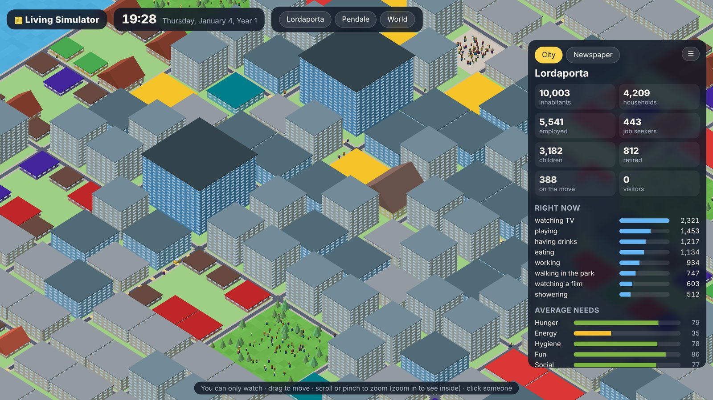

# Living Simulator

*[Leer en español](README.es.md)*

**A shared city that lives on its own.** Living Simulator is an open-source, low-poly
life simulation that runs in your browser. Around 10,000 inhabitants work, go to
school, shop, eat out, watch TV, sleep, pay rent and visit the next town. They make
friends, fall in love, marry, have or adopt children, grow old, fall ill and eventually die,
and villagers commute to jobs in the city. Businesses hire, fire and sometimes go bankrupt,
and the town hall collects taxes. Towns **grow**: when they lack homes, shops, daycare or
jobs, investors pay for new buildings and builders put them up, floor by floor, and new
streets are laid out into the farmland. Now and then someone steals, breaks into a home or
starts a fight; the police investigate, courts judge and convicts go to jail (nothing
graphic). When too many people cannot find work, settlers found **new towns** down new
highways, and the world map grows. The university and research labs develop **new
technology** (electric buses, solar roofs, vertical farms, maglev trains…) that spreads
from town to town and changes how they live. They follow their own
needs and daily agendas, and nobody controls them. **You can only watch.** Every visitor
sees the same city at the same moment, and it keeps living when nobody is looking.

**▶ Live demo: <https://carlesclimentoltra.github.io/LivingSimulator/>**



- **Real time:** 1 simulated day = 1 real hour (1 simulated minute = 2.5 seconds).
- **One world for everyone:** it is deterministic, so your browser computes exactly the
  same city as everybody else's.
- **No servers, no logins, no cost:** GitHub Actions advances the world and GitHub
  Pages serves it. It needs no paid API and uses no generative AI.
- **Built to grow:** the world is split into regions (towns) that talk only through
  messages. The goal is hundreds of towns and up to a million inhabitants (see the
  [roadmap](docs/ROADMAP.md)).

## What you can do

- Drag to move, scroll or pinch to zoom. Zoom in close and the buildings turn see-through,
  so you can watch people sleeping, working at their desks or watching TV.
- Click anyone to open their **card**: name, age, family tree, partner, education,
  health, job, needs, money and a **diary** of their latest moments. Press *Follow* to keep the camera on them.
- Click a building to see who is inside and, for a business, its owner, prices, stock,
  staff and yesterday's books.
- Watch the town grow: fenced building sites, scaffolding and cranes, builders in yellow
  helmets, and a *Construction* panel with every project, who pays for it and how far it
  got. Click a site to see what is being built.
- Follow the **technology tree** in the stats panel and spot its effects in the streets.
- Press *World* to see every town on the map with its figures; click one to go there (it
  starts being simulated in your browser when you arrive).
- Read the police log: incidents marked on the map, police tape, patrol cars, arrests,
  trials and who is in jail.
- Follow the population: a population pyramid, births, deaths, weddings, migration and
  commuters.
- Look at the economy: unemployment, the price of a meal, rents and the town budget, with
  charts of the last 60 days.
- Read the **city stats** and the local **newspaper**, and switch between the city and
  the village down the highway.

You cannot do anything else. Nothing you do can change the world.

## How it works

```
 GitHub Actions (cron, ~20 min)                         Your browser
 ┌──────────────────────────────┐   GitHub Pages   ┌───────────────────────────────┐
 │ livingsim-runner (Rust)      │ ───────────────▶ │ Web Worker: livingsim-wasm    │
 │ • continue from last state   │  manifest.json   │ • download one region + log   │
 │ • simulate up to now + 6 h   │  region files    │ • catch up to "now" (<1 s)    │
 │ • publish checkpoints + log  │  message logs    │ • then 1 tick every 2.5 s     │
 └──────────────────────────────┘                  │ Three.js: instanced low-poly  │
                                                   └───────────────────────────────┘
```

- **`livingsim-core`** is a pure, deterministic simulation. It has no I/O, no clock and
  no floats. Its randomness comes only from seeds, and it iterates only in fixed orders.
  The work is **event-driven**: each agent schedules its next decision, so the cost
  grows with the number of events, not with agents × ticks. Needs are computed lazily,
  trips are analytic, and route distances are cached.
- **Regions** (one per town) exchange **messages** once per simulated hour (trade,
  visitors, reports). That is why your browser can simulate a single town on its own and
  still get a result identical to the runner's.
- The runner works **ahead of real time**, so a late or failed cron run changes nothing
  for visitors.
- **The economy is a closed loop.** Money (US dollars, stored in cents) moves only
  through transfers between people, firms, the town hall and two external accounts (the
  rest of the world and other towns). A test checks that no money is ever created or
  destroyed.
- **Content lives in data.** Professions, buildings, activities, schedules, name
  syllables and newspaper templates are RON files in [`/data`](data/), and you can add
  more without touching the engine.

Read the full design in [docs/ARCHITECTURE.md](docs/ARCHITECTURE.md).

### Current numbers

These are from the Phase 2 build (with the economy), measured on a 4-core machine.

| Benchmark | Result | Target |
|---|---|---|
| 1 simulated day, 10k agents (native) | ~0.2 s | < 0.5 s |
| 1 simulated day, 100k agents (native, parallel) | ~0.65 s | < 5 s |
| 1 simulated day, 1M agents (native, parallel) | ~6 s | < 60 s |
| Catch-up of 1 simulated day, 10k region, WASM (Node) | ~0.3 s | < 1.5 s |
| Memory per agent (incl. 16-entry diary) | 300 B | ≤ 384 B |
| Region checkpoint, 10k inhabitants (compressed) | ~1.5 MB | < 2 MB |

## Run it locally

You need Rust (the version pinned in `rust-toolchain.toml` installs itself), Node 20+
and `wasm-bindgen-cli`:

```sh
rustup target add wasm32-unknown-unknown
cargo install wasm-bindgen-cli --version 0.2.130 --locked

cd web
npm install
npm run wasm     # build the simulation for the browser
npm run world    # create or advance a local world in web/public/world
npm run dev      # open http://localhost:5173
```

`npm run world` acts as your own runner: run it again later to keep the local world
going. Other useful commands:

```sh
cargo test --workspace --release            # tests, including determinism and the golden hash
./scripts/test-wasm.sh                      # native vs WASM hash and catch-up time (Node)
cargo run --release -p livingsim-core --example inspect -- 3   # simulate 3 days, print stats and a diary
cargo run --release -p livingsim-bench --bin bench-report -- --full
```

## Deploy your own world

1. Fork the repository.
2. Go to **Settings → Pages → Build and deployment → Source** and choose
   **GitHub Actions**.
3. Run the **Tick the world** workflow from the Actions tab. If it finds no published
   world, it creates one that starts now. You can choose the seed and the start time
   with the repository variables `LIVINGSIM_SEED` and `LIVINGSIM_EPOCH_MS`.

After that, the cron keeps the world going. Every day a backup goes to the
`world-backups` release, and it is restored automatically if Pages ever loses the data.
GitHub turns off scheduled workflows after 60 days without activity. The workflows
switch themselves back on, and
[ARCHITECTURE §11.3](docs/ARCHITECTURE.md#113-the-60-day-inactivity-problem) explains
the fallbacks.

## Project layout

```
crates/livingsim-core      deterministic simulation (regions, agents, events, generation)
crates/livingsim-content   schemas and validation for /data
crates/livingsim-runner    native CLI used by GitHub Actions
crates/livingsim-wasm      wasm-bindgen API for the browser worker
crates/livingsim-bench     criterion benchmarks and bench-report
data/                      all content (RON)
web/                       TypeScript + Vite + Three.js frontend
docs/                      architecture, roadmap, good first issues
```

## Contributing

You are welcome to contribute. Content-only pull requests are the easiest way to start:
a new profession, building, activity or name style goes in `/data` and needs no Rust. See
[CONTRIBUTING.md](CONTRIBUTING.md) and the list of
[good first issues](docs/GOOD_FIRST_ISSUES.md). Please follow our
[Code of Conduct](CODE_OF_CONDUCT.md).

## License

You can use this project under either of these licenses, at your option:

- Apache License 2.0 ([LICENSE-APACHE](LICENSE-APACHE))
- MIT license ([LICENSE-MIT](LICENSE-MIT))

Unless you say otherwise, any contribution you intentionally submit for inclusion is
dual-licensed in the same way, without any additional terms or conditions.

All names of people, towns and businesses are generated from invented syllables. Any
resemblance to real people is a coincidence.
